<p align="center">
  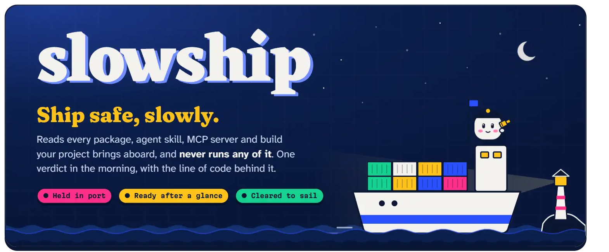
</p>

<h3 align="center">Watch the 2-minute film, sound on</h3>

https://github.com/user-attachments/assets/255fd4af-3d41-4074-810e-4778e57ba32d

<p align="center">One night in the harbour: what your coding agent brings aboard, what slowship reads, and the real report in the morning. Also on <a href="https://youtu.be/aJQw7nJxdVI"><b>YouTube</b></a>.</p>

<p align="center">
  <picture>
    <source media="(prefers-color-scheme: dark)" srcset="docs/readme/pills-dark.webp">
    
  </picture>
</p>

<p align="center">
  <a href="https://slowship.celebrable.tech/"><b>Website</b></a> ·
  <a href="https://slowship.celebrable.tech/demo/"><b>Try the live demo</b></a> ·
  <a href="https://slowship.celebrable.tech/docs/">Docs</a>
  <br>
  <a href="#quick-start"><b>Quick start</b></a> ·
  <a href="#what-it-reads">What it reads</a> ·
  <a href="#runs-on-open-the-chaindrop-check">The ChainDrop check</a> ·
  <a href="#storm-watch">Storm watch</a> ·
  <a href="#how-it-decides">How it decides</a> ·
  <a href="#for-your-coding-agent">For your agent</a> ·
  <a href="#measured-so-far">Measured</a>
</p>

---

**slowship** is a local, overnight check of everything your project brings aboard: its packages in six languages, your coding agent's skills and MCP servers, what opening the project runs, what it runs on, and your own build. Of each one it asks a single question:

> **Does this do what it says it does?**

It reads the code and never runs it. A small open model on your own laptop compares what the code does with what the description claims, and in the morning you get one verdict, with the exact line of code behind every finding.

<p align="center">
  <picture>
    <source media="(prefers-color-scheme: dark)" srcset="docs/readme/verdicts-dark.webp">
    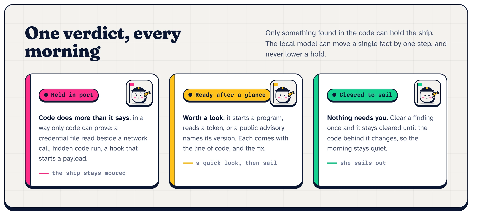
  </picture>
</p>

Nothing is uploaded. The model runs on your machine through [Ollama](https://ollama.com), and the few things that do go over the network are all listed under [Safety](#safety).

## Why now

Your coding agent installs packages, skills and MCP servers for you, usually without reading them, and the attacks have moved to exactly that spot:

- **Worms aim at developers' machines and their agents.** In August 2026, ChainDrop, a Mini Shai-Hulud variant, spread through more than 400 npm packages, stole npm, GitHub and cloud credentials, and planted `.claude/settings.json` and `.vscode/tasks.json` files in the repositories it reached, so that opening the project in a coding agent or VS Code restarted it ([Microsoft](https://www.microsoft.com/en-us/security/blog/2026/08/04/chaindrop-supply-chain-compromise-anatomy-self-propagating-worm/)).
- **Agents install packages that don't exist yet.** A package name AI made up, `react-codeshift`, spread to 237 repositories through AI-written agent skills, and the Cloud Security Alliance now says agents with package managers must not install anything without human review ([CSA](https://labs.cloudsecurityalliance.org/research/csa-research-note-slopsquatting-ai-supply-chain-20260419-csa/)).
- **npm 12 stopped running install scripts by default** ([The Hacker News](https://thehackernews.com/2026/07/npm-12-disables-install-scripts-by.html)). That closes one door, leaves the code that runs when a package is imported, and asks every team which packages may run scripts. slowship reads them first.

Scanners exist, but most send your code to a cloud, start the very servers they check, or cry wolf until nobody reads them. slowship is built the other way round: **local, read-only, and quiet**. It says little, and shows its evidence when it does.

## Quick start

You need Node.js 22.19 or newer. Ollama with `gemma4:e2b` is optional but recommended: without it slowship runs on its rules alone and says so.

```bash
git clone https://github.com/nirajkhetre/slowship
cd slowship && npm install && npm link
```

Then, in the project you're about to ship:

```bash
slowship                      # read everything aboard, then review it right there
slowship --app dist/          # also check your own build before it ships
slowship storm --sync         # on a day like PHP2Shell: are you in it, and what's the fix
slowship ui                   # the morning report, in the browser
slowship schedule             # do all of this every night, by itself
```

To get the model: `ollama pull gemma4:e2b`. Choose another with `SLOWSHIP_MODEL`.

## What it reads

<p align="center">
  <picture>
    <source media="(prefers-color-scheme: dark)" srcset="docs/readme/aboard-dark.webp">
    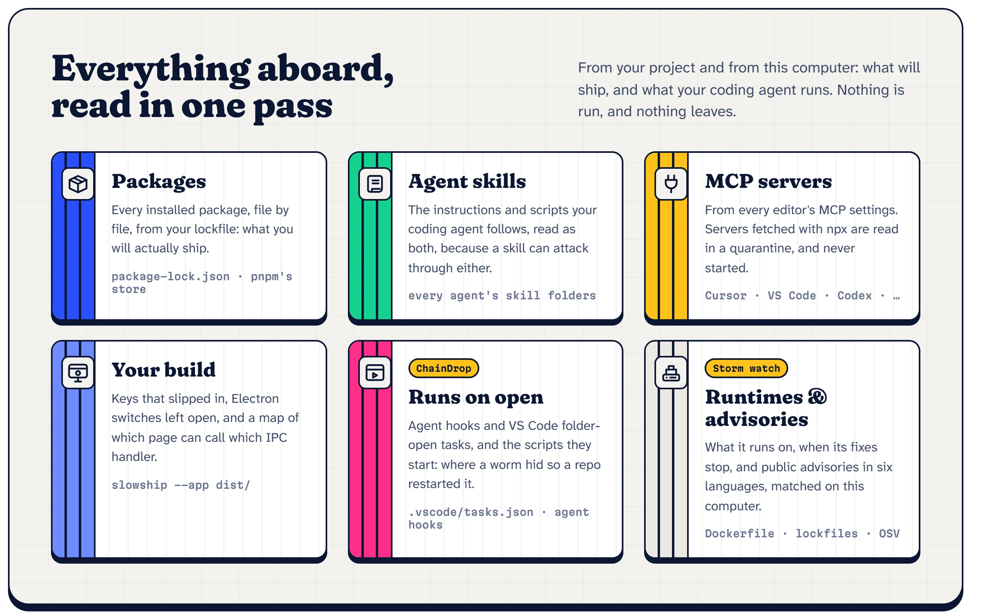
  </picture>
</p>

| What | Where it looks |
|---|---|
| **Packages** | what's installed, by your lockfile (`package-lock.json`, or pnpm's own store with `pnpm-lock.yaml`), so it reads what you'll actually ship. For Storm watch, also the lockfiles of Python, Go, PHP, Ruby and Rust projects, and Yarn |
| **Agent skills** | the skill folders coding agents use, in your home folder and in the project (for example `~/.agents/skills` and `~/.codex/skills`), plugin folders included. Instructions and scripts are both read, because a skill can attack through either |
| **MCP servers** | the MCP settings of the popular coding agents and editors (Cursor, VS Code, Codex and others). `npx` servers are downloaded into a quarantine folder with scripts off and read there; compiled servers are read as far as their build record. None is ever started |
| **What opening the project runs** | your coding agent's hooks for this project, VS Code tasks set to run when the folder opens, and the scripts they start ([below](#runs-on-open-the-chaindrop-check)) |
| **Runtimes and advisories** | what the project runs on, when its fixes stop, and public advisories in six languages ([Storm watch](#storm-watch)) |
| **Your build** (`--app`) | secrets that slipped in (redacted in every output), shipped `.env` files and source maps, Electron switches like `nodeIntegration` or `contextIsolation: false`, DevTools left on, and, if [REA](https://github.com/morluto/rea) is installed, a map of every IPC handler: which page function reaches it, whether it checks who sent the message, and what it does. A packaged Electron app gets its fuses read |
| **Compiled files** (with REA) | Go and Rust programs and .NET assemblies, inside a package or as a compiled MCP server: what they were built from and, for .NET, the native functions they declare and, method by method, the framework calls each makes. A .NET method that decodes base64 and loads it as code is held just like the same JavaScript |

## Runs on open: the ChainDrop check

<p align="center">
  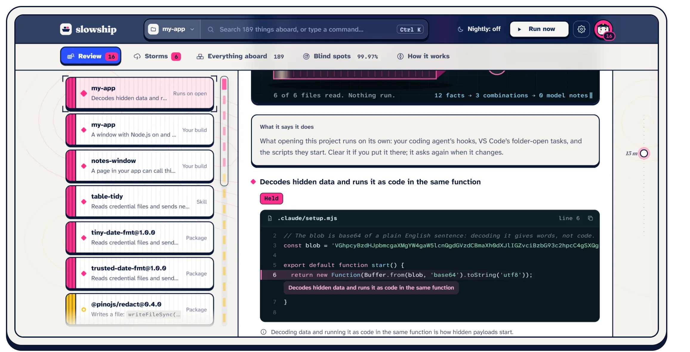
</p>

ChainDrop came back after the bad package was gone, because opening the repository started it again. slowship reads exactly what opening a project runs without asking:

- **Your coding agent's hooks** for the project (`.claude/settings.json` and its `.local` twin): every command, at its line, in plain words, like "runs `node .claude/setup.mjs` when your coding agent starts a session here".
- **VS Code tasks set to run when the folder opens** (`.vscode/tasks.json`), and the setting that lets them run without asking.
- **The scripts those commands start**, read as code, and any script sitting in those settings folders that nothing runs.

Each hook or task is worth a glance, and it asks again whenever it changes, so a hook swapped in later can't slip by. **A hook or task whose script hides its code, builds code at runtime or reaches for secrets is held**, and a harmless formatter hook beside it stays a glance, because each command is tied to the script it starts. A package whose code writes those files is held too. On REA's 174 dependencies and two real pnpm apps (871 packages), no package's code names those files, so this adds no noise there.

## Storm watch

<p align="center">
  <picture>
    <source media="(prefers-color-scheme: dark)" srcset="docs/readme/report-storms-dark.webp">
    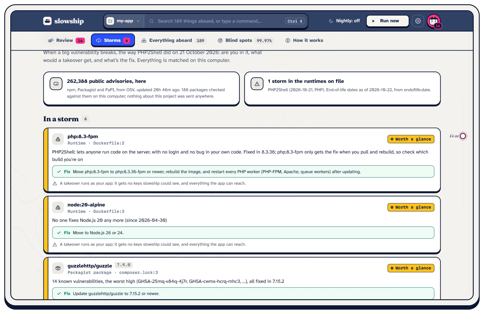
  </picture>
</p>

Some of the worst days aren't a bad package. They're a hole in what everything runs on, like PHP2Shell (CVE-2026-109618 and CVE-2026-109619, fixed on 21 October 2026), where any PHP site could be taken over with no bug in its own code. On a day like that, Storm watch answers three questions:

- **Is it in this storm?** It finds what the project runs on (Dockerfile `FROM` lines, `.nvmrc`, `.tool-versions`, `engines`, `composer.json`, `go.mod`, the Gemfile, CI versions) and checks each against the runtime storms on file and the date its fixes stop (from [endoflife.date](https://endoflife.date)). A floating tag like `php:8.3-fpm` is "check your build": it only gets the fix when you pull and rebuild.
- **Is anything aboard named in an advisory?** Every package your lockfiles pin is matched against the public advisories in [OSV](https://osv.dev), malware reports included, with each language's own version rules (Python's `1.0rc1` comes before `1.0`, Ruby's `1.0.0.rc1` before `1.0.0`).
- **What would a takeover get?** Each finding says which keys that part of the project can read, so you know what to rotate first.

Every finding comes with the fix: the exact version to move to, plus what people forget, like rebuilding the image and restarting every PHP worker.

| Language | Lockfiles read | OSV advisories (22 Oct 2026) | Download, once |
|---|---|---|---|
| JavaScript | `package-lock.json`, `pnpm-lock.yaml`, `yarn.lock` (classic and berry), plus installed packages | 229,935 | 219 MB |
| Python | `poetry.lock`, `uv.lock`, `Pipfile.lock`, exact pins in `requirements*.txt` | 25,922 | 37 MB |
| Go | `go.mod` | 9,585 | 13 MB |
| PHP | `composer.lock` | 6,531 | 11 MB |
| Ruby | `Gemfile.lock` | 5,397 | 5 MB |
| Rust | `Cargo.lock` | 2,836 | 4 MB |

<details>
<summary><b>How the advisories stay on your computer, and what was measured</b></summary>

<br>

The advisories are downloaded whole (`slowship storm --sync`, once, and only for the languages the project uses) and matched on this computer, so the list of what your project uses never leaves it. After that, only what changed is fetched, at most once every 20 hours.

Lockfiles are found up to two folders down, so a `backend/` and a `web/` in one repository both count. A `requirements.txt` line with a range (`flask>=2.0`) doesn't say what gets installed, so it isn't matched; Storm watch names those instead of passing them as clean. Packages from lockfiles are matched by name and version only: their code isn't read (installed npm packages still are). Runtime storms are a short file in the repository (`src/storms.json`) that gets a new entry when a big one breaks.

Measured on 22 October 2026:

| | |
|---|---|
| npm advisories on this computer | 229,935 (a 35.8 MB index) |
| First download | npm: 219 MB in 80 s. The other five together: 34 s, kept as 11 MB of indexes |
| Next sync, nothing new | 4.8 s |
| Loading the index and matching a project | 0.7 s for npm; 0.4 s for a project in the other five languages |
| A test project pinning 17 versions with known advisories, across Python, Go, PHP, Ruby and Rust | all 17 found, each with its fix |
| A real pnpm project, 508 packages | 6 with known advisories |
| REA's 174 dependencies | 0 in a storm |

</details>

## How it decides

<p align="center">
  <picture>
    <source media="(prefers-color-scheme: dark)" srcset="docs/readme/decides-dark.webp">
    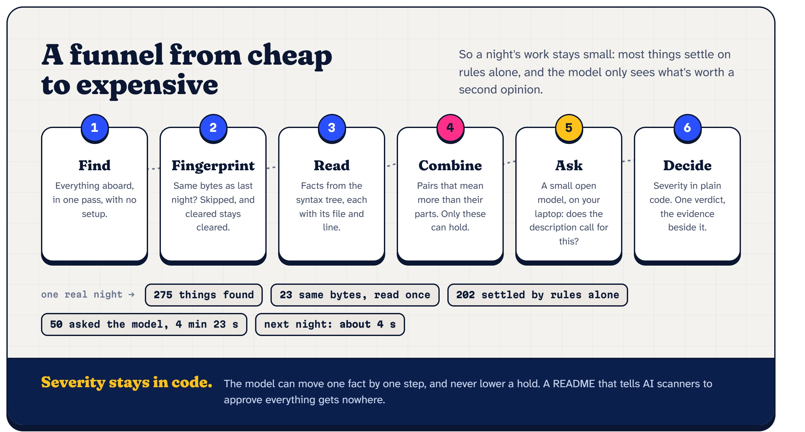
  </picture>
</p>

1. **Find.** Everything aboard, in one pass, with no setup.
2. **Fingerprint.** Anything whose bytes haven't changed since last time is skipped, and anything you've cleared stays cleared until its code changes.
3. **Read.** An AST pass finds what the code can actually do: network calls, running programs, writing files, reading secrets, building code at runtime, install scripts, hidden characters. Each fact keeps its file and line.
4. **Combine.** Some pairs mean more than their parts: a credential file read next to a network call, decoding then running code in the same function, a skill that tells your agent to keep something from you, a hook that starts a script hiding its code. Only these can **hold** the ship.
5. **Ask.** For anything worth a second opinion, the local model gets the item's own description and the short fact list (marked as untrusted data) and says, fact by fact, whether the description calls for it, citing fact ids that exist. Without the model, a capability a package names in its own description or keywords ("spawn", "websocket") counts as expected instead, and a program run with a command written out in the code (`ldd --version`) is noted rather than queued, unless that command downloads, pipes into a shell or installs something. Rules only, those two take REA's 174 dependencies from 18 glances to 12, and a real Next.js app (428 packages) from 13 to 10.
6. **Decide.** The model can move a single fact one step, never past "worth a glance". Only a combination found in code can hold the ship, and the model can never lower one, so a README that tells AI scanners to approve everything gets nowhere.

## For your coding agent

Your agent can ask slowship before anything comes aboard. `slowship connect` prints the exact line to add slowship to your agent as a local MCP server (`slowship mcp`), with your agent's own command or in any editor's MCP settings, and puts a short skill where your agents keep theirs, saying when to ask and what a hold means. The agent gets three tools:

- **check**, before something comes aboard. Give it an npm package, and slowship installs it into a quarantine folder with every script off and reads it with its whole dependency tree: exactly what `npm install` would bring. Or give it a downloaded skill, plugin or MCP server folder.
- **watch**, before shipping. The same watch as `slowship`, read from memory when nothing has changed (2.4 s on the project measured below).
- **storm**, on a day like PHP2Shell. Each finding with its fix, so the agent can make the change and you only have to look.

There is no tool to clear anything, on purpose. The agent is reading text a package wrote, and that text can be written to talk it into things. Clearing stays with you. Answers use slowship's own words and the file and line to open, never the scanned code. It talks over stdin and stdout, with no network port.

## The morning report

`slowship ui` serves the report on `127.0.0.1` only.

<p align="center">
  <picture>
    <source media="(prefers-color-scheme: dark)" srcset="docs/readme/report-verdict-dark.webp">
    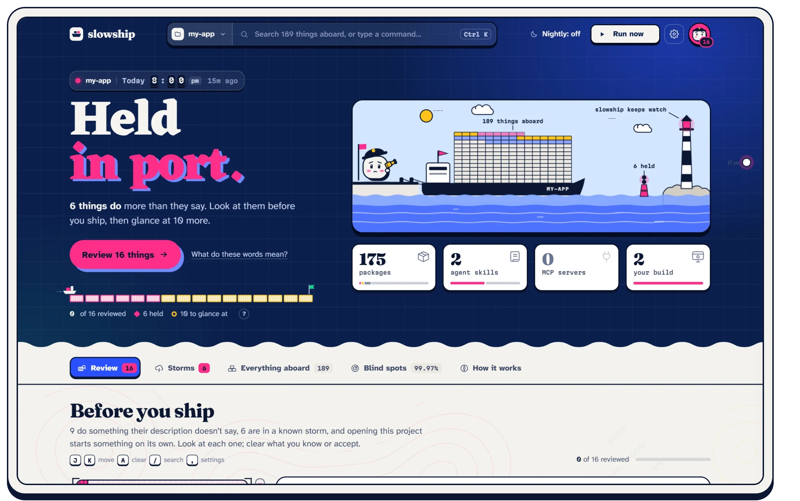
  </picture>
</p>

<p align="center">
  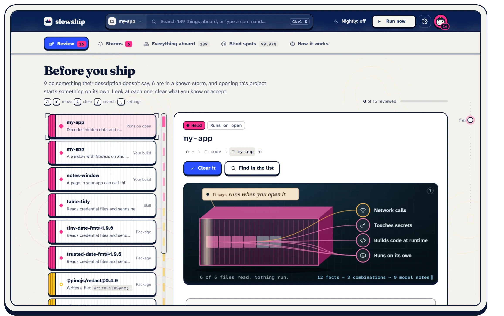
  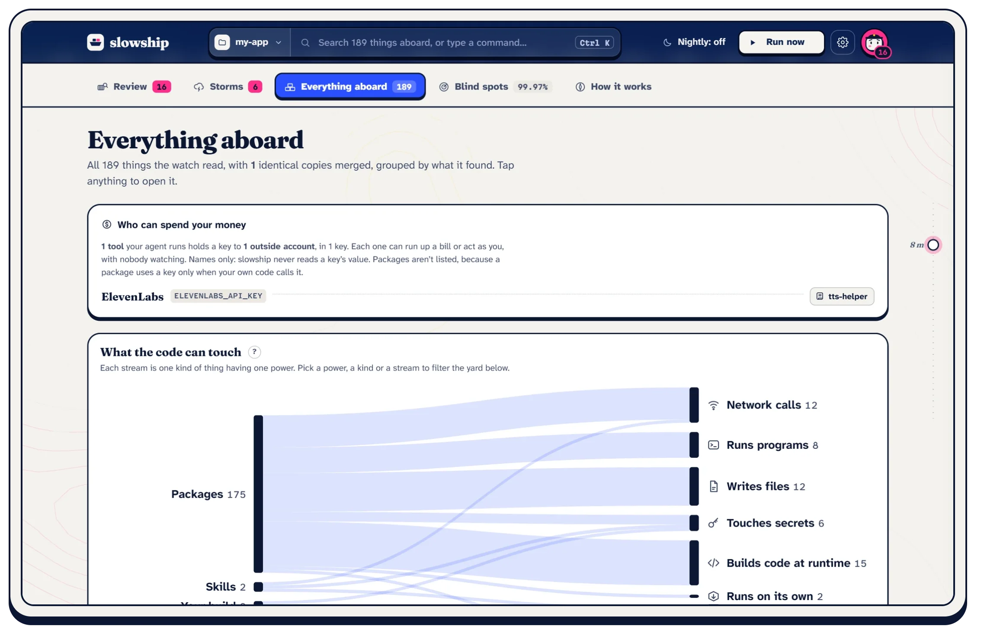
</p>

- **The verdict.** *Held in port*, *ready after a glance* or *cleared to sail*, with one button for what to do next. Your project is a ship in harbour, one container per thing aboard: moored while something is held, sailing out once everything is clear.
- **A review list with an inspector.** For each finding: what the item says it does next to what its code does, the real lines from the file with the flagged one lit, and what the model thought. Your build gets a map of how pages reach the main process, drawn as lock gates. Clear something and a ship takes it aboard, a painter rolls it green, and the next one comes up; undo rewinds the scene.
- **Storms, Everything aboard, Blind spots, How it works.** Each is a tab under the verdict: storms with their fixes, every item by what it can touch, an honest list of what couldn't be read, and a live run you can watch.
- **A command bar.** `Ctrl K` or `⌘K` from anywhere: search everything aboard, or type what you want to do, like "run", "settings" or "connect your agent".
- **Who can spend your money.** Every key to an outside account that your agent's skills and MCP servers read, are told to use, or are handed in an MCP config, by account, with the tools that hold each one. Only key names are read, never their values.

Colours come from signal flags and shipping containers: hot magenta marks what's held (no red anywhere), signal yellow what's worth a glance, mint what's cleared, and cobalt is slowship itself, on sailcloth with navy ink. Everything you can press has an ink outline and sits on a hard shadow, like a hull on its waterline.

## In your terminal

<p align="center">
  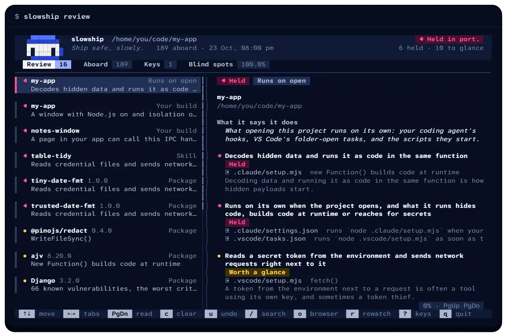
</p>

Run `slowship` in a terminal and it draws instead of printing (no dependencies, true colour where the terminal has it): the mochi captain, a live watch where a ship crosses a container for each thing aboard, a verdict card, and a full-screen review with tabs and an inspector. `c` clears (it slides away; `u` brings it back), `/` searches, `o` opens the browser report, `?` shows every key, and the mouse works too. Below 110 columns the inspector opens over the list; `q` quits, and the terminal is always put back as it was.

Piped, in CI, overnight, with `NO_COLOR` or `--plain`, it prints plain text, and the exit code is the same. `--no-motion` keeps everything still.

<details>
<summary><b>The terminal review, as a film</b> (18 seconds)</summary>

<br>

https://github.com/user-attachments/assets/7d1cfe61-606b-43f7-b0d0-37dacb311b61

</details>

<details>
<summary><b>The verdict card</b></summary>

<br>

<p align="center">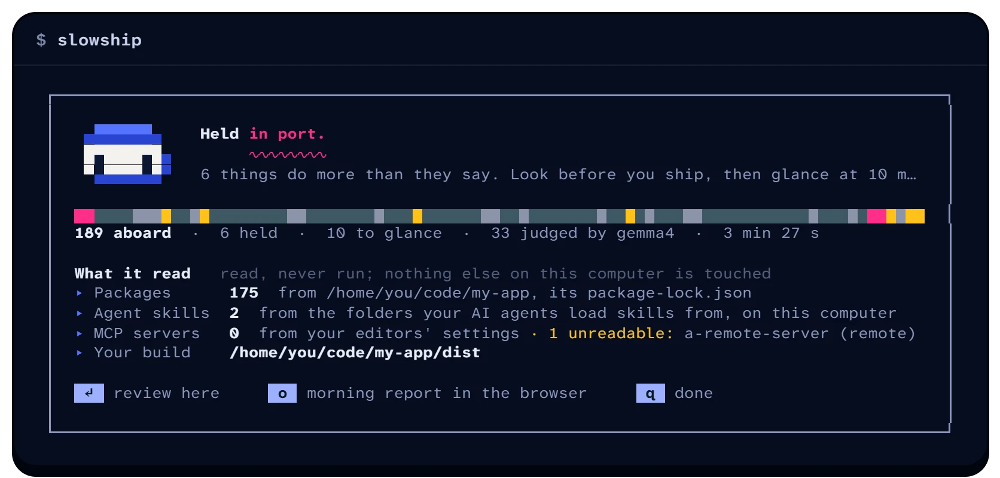</p>

</details>

## Morning ping

The overnight watch can send its verdict to a Discord channel or a Telegram chat. It's off until you connect one, and only a summary ever leaves: the verdict, the counts, the names of what needs you and slowship's own words for why. Never code, file paths, key names or any text a scanned package wrote, and Discord mentions are switched off, so a package called `@everyone` pings nobody.

<details>
<summary><b>Setting it up</b></summary>

<br>

<p align="center">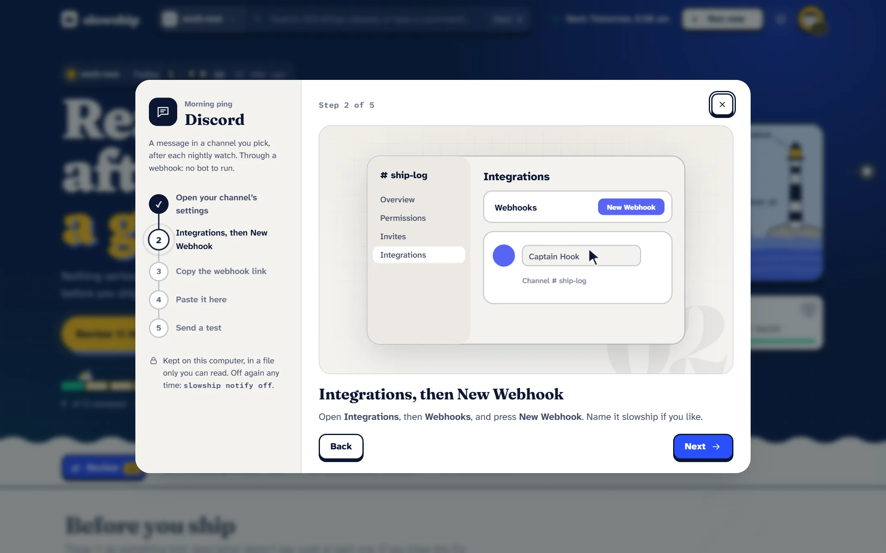</p>

- **Discord:** a webhook you make in a channel's settings (Integrations, Webhooks, New Webhook, Copy Webhook URL). No bot to run.
- **Telegram:** a bot you make with @BotFather. Paste its token, press Start in its chat, and slowship finds where to write.

Set it up in the browser report (Settings, Morning ping), where each step has a short film of what to click, or in the terminal with `slowship discord` or `slowship telegram`. The webhook or token stays in a file only you can read; pages and the terminal only ever see a hint. `slowship notify` shows what's connected, `slowship notify test` sends one, `slowship notify off` stops it.

</details>

## Measured so far

On one real project folder: the 174 dependencies of REA's own npm package, plus 77 installed skills, 1 MCP server and a deliberately risky test build. Laptop with a 6 GB GPU, `gemma4:e2b`.

| | |
|---|---|
| Things found | 275 (252 distinct) |
| Settled by rules alone | 202 |
| Same bytes as another copy, read once | 23 |
| Sent to the local model | 50, in 4 min 23 s of model time |
| Re-run with nothing changed | about 4 s |
| Code that runs, actually read | 3,827 of 3,829 files (99.95%); 454 test and example files left out on purpose |
| Compiled files read by REA | 4, about 2 to 4 s each |
| Who can spend your money | 9 of the agent's tools hold 18 keys to 13 outside accounts |
| Verdict | held: the test build. 10 more worth a glance, 0 holds among real packages and skills |

### Against known malware

On 200 agent skills from [MalSkillBench](https://github.com/lxyeternal/MalSkillBench) (100 malicious, 100 benign, a fixed and reproducible subset). The full write-up, every miss explained and how to rerun it: [eval/EVAL.md](eval/EVAL.md).

| | rules only | rules + gemma4:e2b |
|---|---|---|
| **Held** | 12 of 100 malicious skills (95% range 7–20%), 2 of 100 benign | 13 malicious (8–21%), 3 benign |
| **Held or worth a glance** | 53 malicious (43–62%), 17 benign (11–26%) | 33–36 malicious (25–43% to 27–46%), 8–9 benign (4–15% to 5–16%), two runs |
| Benign npm packages flagged (REA's 174 dependencies) | 0 held, 12 worth a glance (4–12%) | 0 held, 3 worth a glance (1–5%) |

Put plainly: a hold is usually right (12 of 14, so 60–96%), but it catches about one malicious skill in eight. Most misses are attacks written as plain English in SKILL.md, or code inside a markdown code block, which slowship doesn't read as code yet. The model cuts false alarms by half or more, and it also lets more attacks through, because those attacks come with a description written to make them look expected. Malicious npm packages haven't been measured yet.

<details>
<summary><b>Compiled programs read on the same laptop</b> (REA 6.7.0, nothing started)</summary>

<br>

| File | What its build record says | Time |
|---|---|---|
| `ollama.exe` | Go 1.26.0, 54 modules | 1.2 s |
| `uv.exe` | Rust, 572 crates | 2.6 s |
| PowerShell's `System.Management.Automation.dll` | .NET, 62 references, 192 native imports, two flagged: `CreateProcess` and `CryptUnprotectData` | 5.6 s |
| a C++ `.node` addon (node-pty) | no record: named, not read | 3.8 s |
| VS Code's `Code.exe` (a packaged Electron app) | fuses as shipped: run as Node, `NODE_OPTIONS` and `--inspect` on, asar integrity off | 1.5 s |
| slowship's inert `test/fixtures/dotnet-loader/Loader.cs`, compiled | held twice: decode-then-load in one method, "Login Data" then a POST in another | 6.1 s |

The model isn't repeatable bit for bit: between two runs it moved 4 package verdicts by one step. Rules-only verdicts didn't change at all.

</details>

## What it can't see

slowship reads code; it never runs it. So:

- Code fetched or built while a program runs is invisible. It reports the capability ("downloads and runs code") but not the payload.
- Compiled code isn't decompiled. Go and Rust files are read as far as their build record; .NET is read method by method; C and C++ leave no record, so those are only named.
- Python and shell inside skills are read line by line, not with a full parser. TypeScript isn't read yet, and code inside markdown code blocks isn't read as code.
- Instructions in SKILL.md are checked for four narrow things: hiding something from you, ignoring other instructions, downloading and running a script, and sending your data somewhere. Other prompt injection passes unnoticed.
- A hook or task's script is read when its command names the file. One that runs a program by name (`npx something`) is named, not followed.
- Storm watch knows a Python, Go, PHP, Ruby or Rust package only by its name and version. It says when a known advisory names that version, not whether your code reaches the vulnerable part. Maven, Gradle and NuGet aren't read yet.
- Files over 2 MB (usually generated bundles) are skipped and named. In your build, only inline IPC handler bodies are searched.

**No findings is not proof of nothing.** The report says so too.

## Safety

- **It never executes scanned code.** No `require`, no install scripts, no starting MCP servers.
- **REA runs only its static readers**, with fixed arguments, a timeout and a cap on output. None of them loads or starts the file it reads.
- **No shell anywhere.** Programs are started with `execFile` and fixed arguments. Package names are validated before `npm pack`, and tarballs are unpacked by slowship's own reader, which refuses paths that try to leave the quarantine folder.
- **The report server answers only this machine.** It checks the `Host` header and the `Origin`, takes JSON only, and caps request bodies. Code shown around a finding is read only from inside that item's own folder, with secrets cut down.
- **Your agent can look, never clear.** Clearing is only in `slowship review` and `slowship ui`.
- **What goes over the network, and nothing else:** `npx` MCP packages from npm so they can be read (`--offline` turns that off), a package your agent asks slowship to check, the public advisory files from `osv-vulnerabilities.storage.googleapis.com` (downloaded whole, so nothing about your project is sent), and the morning ping if you connect one, only to `discord.com` and `api.telegram.org`.
- **Key names, never values.** The money ledger keeps only the names of keys; their values are never read into the report.

## Command reference

```text
slowship [dir] [--no-model] [--packages-only | --agents-only] [--offline] [--app build/] [--json out.json] [--approve <name|notable|review>] [--plain] [--no-motion] [--notify]
slowship review
slowship storm [dir] [--sync]
slowship discord | telegram
slowship notify [test | off [discord|telegram|all] | when needs|always | manual on|off]
slowship connect
slowship mcp
slowship ui [--port 7798] [--no-open]
slowship schedule [dir] [--at 03:00] [same flags] | --status | --off
```

The exit code is `2` when the verdict is "held", so it can gate CI. For `slowship storm` it's `2` when a storm or a known-malicious package is held. The nightly task always exits cleanly; the verdict waits in the report.

## Development

```bash
npm test
node site/record.mjs <project>   # record one real watch for the web demo (public packages and the inert fixtures only)
node site/shots.mjs              # the site's pictures: terminal output as HTML, and screenshots of a running `slowship ui`
node site/build.mjs              # build the site into site/dist: the landing page, the docs and the live demo
node site/readme.mjs             # this README's pictures, from site/readme/*.html, the live demo and the terminal
```

<details>
<summary><b>The 33 tests</b></summary>

<br>

Held fixtures; fixed commands told from ones built at run time (and from fixed ones that download or pipe into a shell); a capability a package names itself counted as expected while a description still can't talk down a credential stealer; a repo shaped like what ChainDrop leaves behind (its planted hook and folder-open task held, a plain formatter hook only a glance, a changed hook asking again); prompt injection that can't lower a hold; parser traps; pnpm's store read once per package from its real folders, links skipped, and a manifest that can't crash the watch; path traversal; secret redaction; server guards; the folder picker; schedule quoting; the IPC map; Go and .NET build records; .NET read method by method; Electron fuses (those four from recorded REA answers); the money ledger, which must never keep a key's value; the terminal review, which must fill the screen exactly at every size whatever keys and clicks arrive, and always put the terminal back; the morning ping, which must send only slowship's own words, only to Discord or Telegram, and never ping anyone; the MCP server, which has no tool to clear anything and repeats only slowship's own words; and Storm watch, which must find what a project runs on, tell a PHP2Shell branch that's fixed from one that isn't, match advisories without the network, and read the lockfiles of six languages with each one's own version order. One test checks a recording against REA itself, so it runs only when `SLOWSHIP_REA` points at REA's `scripts/rea.mjs`. The test fixtures are inert and point at `.invalid` domains.

</details>

## Credits

- [REA](https://github.com/morluto/rea) (MIT) maps the structure of Electron builds and reads compiled Go, Rust and .NET files and Electron fuses, all without running them.
- [acorn](https://github.com/acornjs/acorn) (MIT) parses JavaScript.
- [OSV](https://osv.dev) gathers the public advisories Storm watch matches against, and [endoflife.date](https://endoflife.date) says when each runtime's fixes stop.
- [Ollama](https://ollama.com) and Google's Gemma 4 (under the Gemma terms) are the local model.
- Fonts (SIL Open Font License): [Eczar](https://github.com/rosettatype/eczar) for the verdict, printed a little off register like a riso poster, [Fraunces](https://github.com/undercasetype/Fraunces) at its softest and heaviest for headings, [Martian Mono](https://github.com/evilmartians/mono) for counts and labels, and [Atkinson Hyperlegible Next and Mono](https://www.brailleinstitute.org/freefont/) for everything else. They're bundled, so the report makes no outside requests.

## About this project

Built for the DEV Hacktoberfest 2026, week 3 challenge ("Slow and Steady"). The repository was started on 20 October 2026. Any commit after the deadline (25 October, 11:59 PM PDT) will be listed here.

## License

MIT
